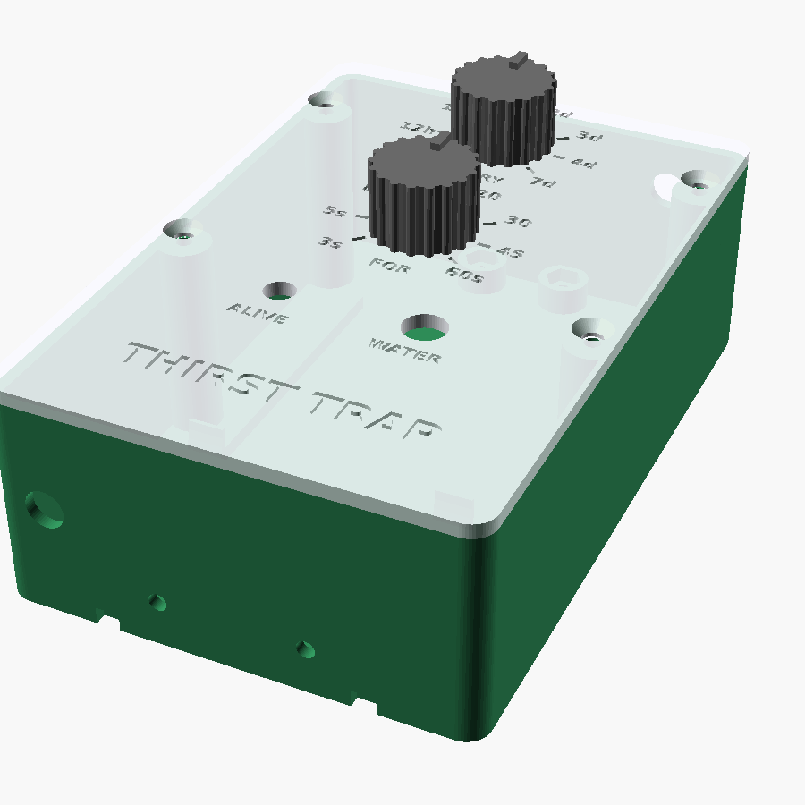
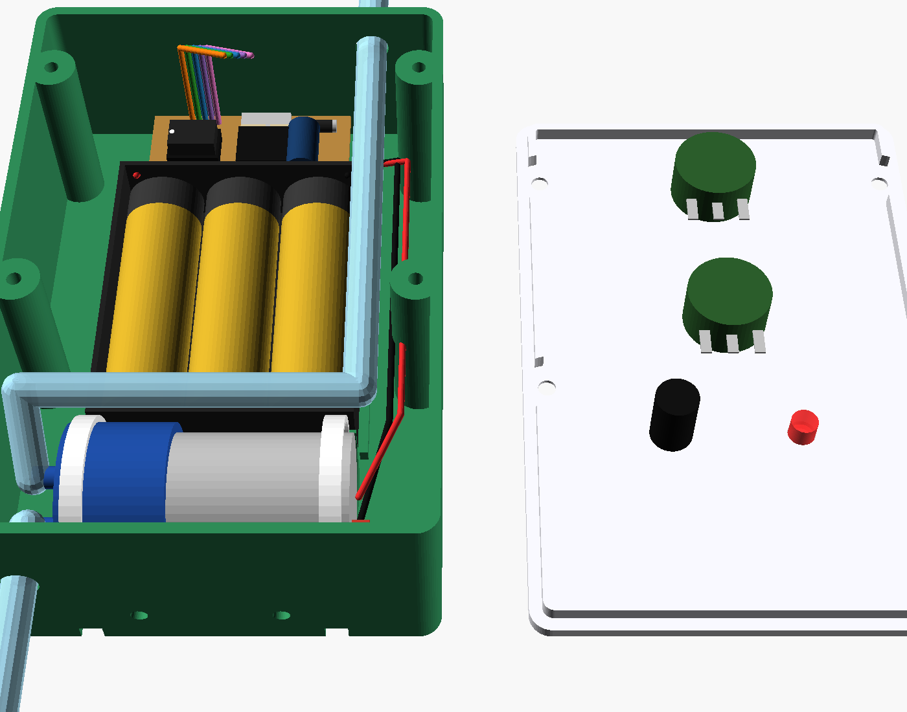
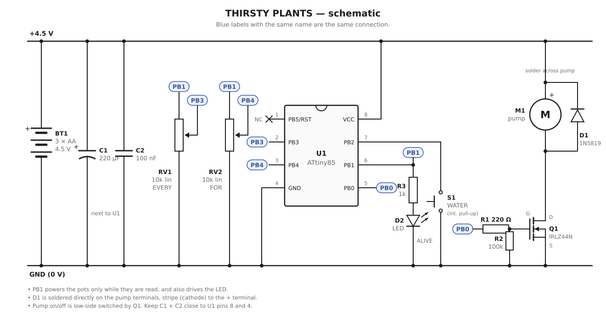
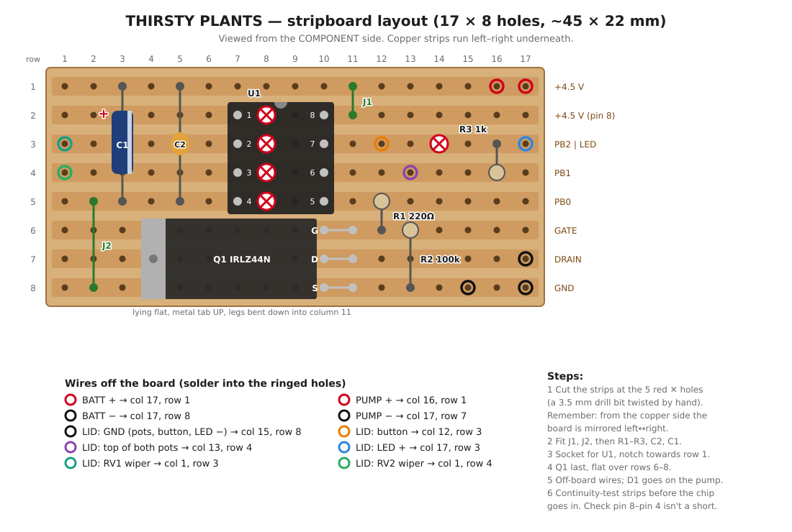

# THIRSTY PLANTS — clip-on timed plant waterer



Hangs on the rim of a pot, sucks water out of a bottle through a tube, squirts it into the soil on a timer, sleeps the rest of the time. 3×AA, no mains, no Wi-Fi, no app, no subscription. Two dials: **EVERY** (6 h to 7 days) and **FOR** (3 to 60 s of pumping).

```
  bottle ──tube──▶ [ box on pot rim: ATtiny85 + pump + 3xAA ] ──tube──▶ drip stake in soil
  (sinker keeps the        (sleeps at ~5 µA, wakes every 8 s,
   intake at the bottom)     counts, pumps, goes back to sleep)
```

## Bill of materials (target: under £10)

Rough AliExpress prices; Amazon UK multipacks cost more but leave you spares. Prices move, so check. For an Amazon UK basket, see [PARTS-AMAZON.md](PARTS-AMAZON.md).



| Part | Notes | ~£ |
|---|---|---|
| ATtiny85-20PU (DIP-8) + 8-pin socket | the brain | 1.50 |
| Mini self-priming diaphragm pump, 3–6 V | the cheap ~27 mm "micro water pump" type. Must be **self-priming** (pulls water up the tube); a submersible one won't work | 1.80 |
| 1 m silicone tube, 4 mm ID / 6 mm OD | check it fits your pump's nozzles | 0.80 |
| 3×AA holder (side-by-side, flat) | ~58×47×16 mm | 0.60 |
| Logic-level N-MOSFET: IRLZ44N or IRLB8721 (TO-220), or AO3400 on an adapter | switches the pump. **Not** an IRFZ44N, it won't switch fully at 4.5 V | 0.40 |
| 1N5819 (or 1N4007) diode | flyback across the pump | 0.05 |
| 2 × 10k linear pot, WH148 16 mm, 6 mm shaft | the dials | 0.40 |
| PBS-110 7 mm momentary button | WATER button | 0.15 |
| 5 mm LED + 1k resistor | ALIVE light | 0.05 |
| 220 Ω, 100k resistors | gate resistor, gate pull-down | 0.02 |
| 220 µF 10 V electrolytic + 100 nF ceramic | stops the MCU browning out when the pump starts | 0.10 |
| Stripboard, 17 × 8 holes (~45×22 mm), hookup wire | | 0.30 |
| 6 × M3 screws (4 for the lid, 2 for the clip) + 2 M3 nuts, 1 M8 nut | | 0.40 |
| ~70 g PETG | box, lid, clip, stake, sinker, 2 knobs | 1.40 |
| **Total** | not counting batteries | **≈ £8** |

You also need a way to program the ATtiny: an Uno/Nano running *ArduinoISP*, or a £2 USBasp. If you have neither, an **Arduino Pro Mini 3.3 V/8 MHz** (~£2.50) with its power LED and regulator removed works too. Pin numbers change, the idea doesn't.

## Wiring



### Stripboard layout



The layout has been connectivity-checked against the schematic. The flyback diode D1 isn't on the board: solder it straight across the pump terminals.

<details><summary>Plain-text version</summary>

```
 BATT+ (4.5V) ──┬───────────────┬──────────────┬─────── ATtiny pin 8 (VCC)
                │               │              │
             [220µF]+        [100nF]        PUMP +
                │               │              │  ┌──|◀──┐  1N5819: stripe (cathode) to BATT+
 BATT− (GND) ───┴───────────────┴───────┐    PUMP −┘       │
                                        │      │           │
                                        │      └───────────┴── MOSFET Drain
                                        └───────────────────── MOSFET Source
   ATtiny pin 5 (PB0) ──[220Ω]──┬──────────── MOSFET Gate
                                └─[100k]──── GND

   ATtiny pin 6 (PB1) ──[1k]──LED▶── GND
   ATtiny pin 6 (PB1) ──────┬─────────────┐            (PB1 also powers the pots,
                         INTERVAL pot   DURATION pot     only while they're being read)
                          top │           top │
   ATtiny pin 2 (PB3) ── wiper┘           wiper┘── ATtiny pin 3 (PB4)
                     bottom ─ GND        bottom ─ GND

   ATtiny pin 7 (PB2) ── button ── GND        (internal pull-up)
   ATtiny pin 4 ── GND
```

</details>

Put the 220 µF and 100 nF right by the ATtiny's pins 8 and 4. The flyback diode goes across the pump terminals, not somewhere convenient three inches away.

Wire the pots so turning them **clockwise** increases the setting (wiper reads higher). If the dial reads backwards, swap the two outer pot legs.

## Firmware

`firmware/thirsty_plants/thirsty_plants.ino`. It compiles cleanly to about 600 bytes, out of 8 KB.

1. Arduino IDE → Board Manager URL `http://drazzy.com/package_drazzy.com_index.json` → install **ATTinyCore**.
2. Board: *ATtiny25/45/85 (No bootloader)*, Chip: ATtiny85, Clock: **1 MHz internal**, BOD: **disabled**, millis: enabled.
3. Programmer: *Arduino as ISP* (or USBasp). Run **Burn Bootloader** once to set the fuses, then **Upload Using Programmer**.

### How it behaves

| You do | It does |
|---|---|
| Put batteries in | blinks the EVERY setting (1–8 slow blinks), starts counting |
| Short press WATER | blinks the EVERY setting, waters for the FOR time, **restarts the countdown**. Press it at the time of day you want it to water. |
| Hold WATER > 0.8 s | pump runs while you hold it (prime the tube, top up, measure flow), max 2 minutes |
| Nothing | tiny blip once a minute = alive. Double blip = batteries getting low. Three fast blips at watering time = batteries flat, skipped. |

The dials are only read at watering time or when you press the button, so after changing them, press WATER once.

## Printing (Bambu A1, PETG)

`stl/` has every part, already in print orientation. `thirsty_plants.scad` is fully parametric: **measure your pump, battery holder and pot rim, then fix the numbers at the top** before you print. Cheap parts vary by a few mm from seller to seller.

| Part | Orientation | Notes |
|---|---|---|
| `box.stl` | back on the bed | no supports |
| `lid.stl` | face down | the engraved labels go on the bed side, so a textured PEI plate gives a nice finish. With the AMS you can do a filament swap at 0.6 mm for coloured labels. |
| `clip.stl` | as exported (profile flat on the bed) | 4 walls, 40 % infill: this part takes all the load |
| `stake.stl` | socket down | |
| `sinker.stl` | as exported | push an M8 nut into the base pocket for weight |
| `knob.stl` ×2 | as exported | |

To see how everything fits, render `part="inside"` or `part="exploded"` (both show mock components). Pictures are in `renders/`.

The important parameter is `rim_t` = your pot's rim thickness + ~1 mm. The clip is deliberately narrow (24 mm) so it still seats properly on a curved rim.

## Assembly

1. Screw the clip to the back of the box with 2 × M3 (heads on the pot side, nuts in the hex pockets inside).
2. Zip-tie the pump into its cradles (the slots go through the back wall), or use foam tape.
3. Use double-sided foam tape to stick the battery holder between the ribs and the stripboard onto the two nut bosses at the top. Keep anything on the board under ~10 mm tall, and lay the MOSFET flat.
4. Fit the pots, button and LED to the lid, wire it all up, and route the outlet tube up the front-right void to the top hole. Keep that tube pushed against the right-hand wall, because it runs right past the edge of the battery holder.
5. Inlet tube: from the bottom hole into the bottle, with the sinker on the end. Outlet: over the rim to the drip stake pushed into the soil.
6. Hold WATER until water comes out of the stake. That primes it.

## Calibrate (5 minutes, worth it)

- **Flow:** hold WATER for 10 s into a measuring jug. These pumps typically do somewhere around 5–15 ml/s, depending on how high they're lifting. Pick your FOR setting from that.
- **Clock:** the ATtiny's watchdog "8 s" is really 7–9 s. Time 10 ALIVE blips with your phone, divide by 80, and set `TICK_MS` to that × 1000. Otherwise a "1d" setting could drift by a couple of hours a day. The plant won't care, but you might.

## Battery life

The chip sleeps at ~5 µA (about 0.12 mAh a day). The pump draws ~250 mA, so 20 s a day is ~1.4 mAh. Alkaline AAs will last **many months**, probably a year or more for a daily watering. The bottle runs out long before the batteries do.

## Gotchas

- **Siphoning:** if the bottle sits *higher* than the stake, gravity can push water through the pump when it's off. Keep the bottle lower than the pot rim, or drill a 1 mm hole in the outlet tube at its highest point to break the siphon.
- It's splash-proof, not waterproof. Don't hose it.
- Don't run the pump dry for long, because the diaphragm doesn't like it. Get a bigger bottle or fill it more often.
- 4 × AA would put 6 V+ on the ATtiny, which is over its 5.5 V max. It's **3 × AA** for a reason.

## Licence

MIT. See [LICENSE](LICENSE).
